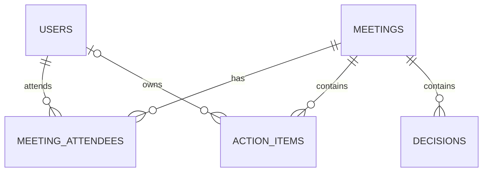

# 05 Data model (SQLite)

> Draft schema. Changes go through numbered migration files in `server/migrations/`.
> Update this file in the same story that changes the schema.

## Relationships


## Soft delete columns
`meetings`, `action_items`, `decisions` and `users` each have `is_deleted INTEGER NOT NULL DEFAULT 0 CHECK (is_deleted IN (0, 1))`.
Rows are never physically deleted (BR-60). The join table `meeting_attendees` has no flag: attendees are
replaced when a meeting is edited, and the whole meeting is hidden when deleted.

## Tables

### `users`
| Column | Type | Notes |
|--------|------|-------|
| id | INTEGER PK AUTOINCREMENT | |
| name | TEXT NOT NULL | 1 to 100 chars (BR-30) |
| email | TEXT NOT NULL UNIQUE | stored lower-case (BR-31) |
| password_hash | TEXT NOT NULL | salted hash only (BR-52). Never returned by the API |
| is_deleted | INTEGER NOT NULL DEFAULT 0 | BR-32 |
| created_at | TEXT NOT NULL | UTC ISO 8601 |

### `meetings`
| Column | Type | Notes |
|--------|------|-------|
| id | INTEGER PK AUTOINCREMENT | |
| title | TEXT NOT NULL | 1 to 200 chars (BR-01) |
| meeting_date | TEXT NOT NULL | `YYYY-MM-DD` |
| notes | TEXT | optional (BR-02) |
| is_deleted | INTEGER NOT NULL DEFAULT 0 | BR-04 |
| created_at | TEXT NOT NULL | UTC ISO 8601 |
| updated_at | TEXT NOT NULL | UTC ISO 8601 |

### `meeting_attendees`
| Column | Type | Notes |
|--------|------|-------|
| meeting_id | INTEGER NOT NULL | FK `meetings.id` |
| user_id | INTEGER NOT NULL | FK `users.id` |
| | | PRIMARY KEY (meeting_id, user_id) |

### `action_items`
| Column | Type | Notes |
|--------|------|-------|
| id | INTEGER PK AUTOINCREMENT | |
| meeting_id | INTEGER NOT NULL | FK `meetings.id` |
| description | TEXT NOT NULL | 1 to 500 chars (BR-10) |
| owner_id | INTEGER | FK `users.id`, NULL = Unassigned (BR-11) |
| due_date | TEXT | `YYYY-MM-DD`, optional |
| status | TEXT NOT NULL DEFAULT 'Open' | CHECK in (`Open`, `In progress`, `Done`) (BR-12) |
| completed_at | TEXT | set when status becomes Done (BR-14) |
| is_deleted | INTEGER NOT NULL DEFAULT 0 | BR-60 |
| created_at | TEXT NOT NULL | |
| updated_at | TEXT NOT NULL | |

### `decisions`
| Column | Type | Notes |
|--------|------|-------|
| id | INTEGER PK AUTOINCREMENT | |
| meeting_id | INTEGER NOT NULL | FK `meetings.id` |
| summary | TEXT NOT NULL | 1 to 500 chars (BR-20) |
| context | TEXT | optional |
| is_deleted | INTEGER NOT NULL DEFAULT 0 | BR-60 |
| created_at | TEXT NOT NULL | |

## Indexes (initial)
- `users(email)` (unique)
- `action_items(meeting_id)`, `action_items(owner_id)`, `action_items(status, due_date)`
- `meetings(meeting_date)`

## Query rules
Every query on a soft-deletable table must filter `is_deleted = 0`. Child rows are also hidden when their
meeting is deleted (BR-61), so list queries for action items and decisions join `meetings`:

```sql
-- Dashboard: overdue action items (BR-15, BR-61)
SELECT a.*
FROM action_items a
JOIN meetings m ON m.id = a.meeting_id
WHERE a.is_deleted = 0
  AND m.is_deleted = 0
  AND a.status != 'Done'
  AND a.due_date < date('now');
```

## SQLite notes
- Enable foreign keys on every connection: `PRAGMA foreign_keys = ON;` (off by default in SQLite).
- No `ON DELETE CASCADE` is used, because rows are not physically deleted.
- Enums are enforced with `CHECK` constraints.
- Overdue is a query condition, not a column (BR-15).
